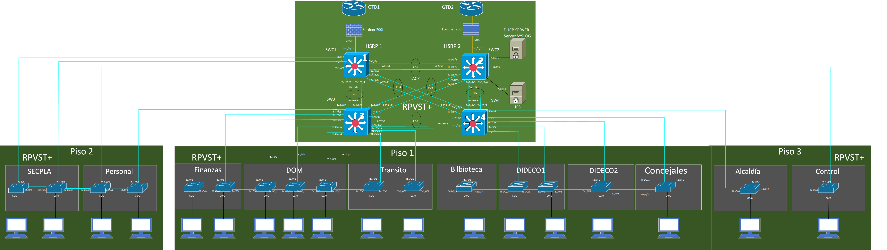
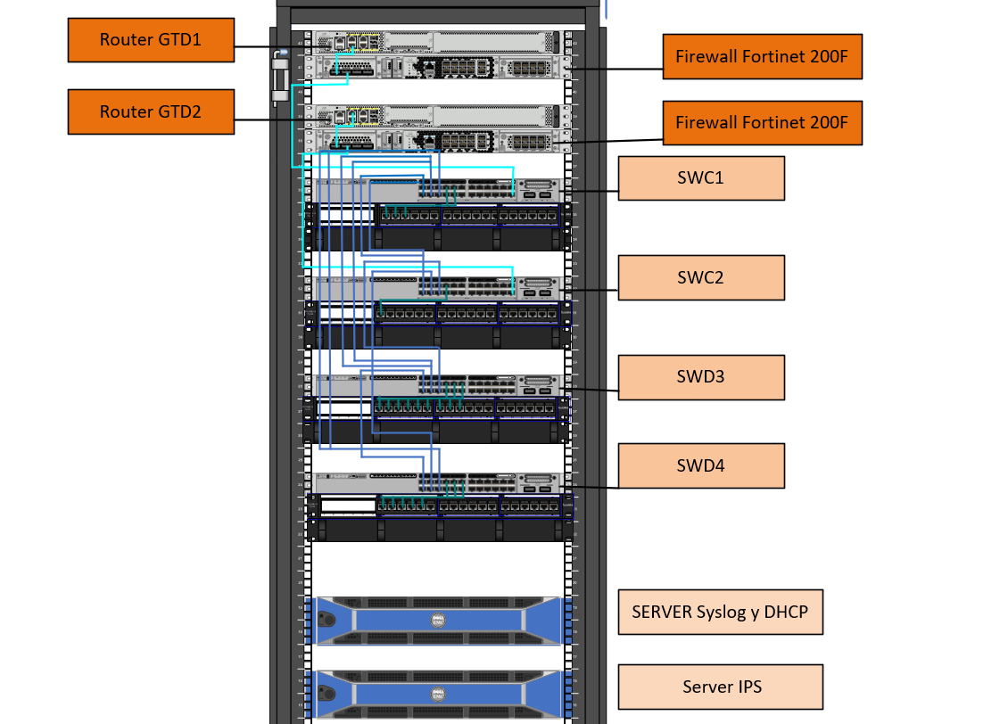

# Renovación de Infraestructura de Red — Municipalidad de Melipilla

Proyecto de título técnico (Duoc UC, 2025) que propone la renovación de la red LAN de la Ilustre Municipalidad de Melipilla, a partir del diagnóstico de una infraestructura sin actualizaciones relevantes en más de una década.

> **Alcance:** propuesta técnica diseñada sobre el levantamiento de la red existente y validada en un entorno de laboratorio. **No fue implementada en la red productiva del municipio.** El direccionamiento IP, las VLANs y el presupuesto corresponden al diseño propuesto, no a la configuración real en operación.

---

## Resumen

| | |
| --- | --- |
| **Institución** | Duoc UC, Sede Melipilla — Administración de Redes y Telecomunicaciones |
| **Tipo** | Proyecto de título técnico (propuesta validada en laboratorio) |
| **Período** | Marzo a agosto de 2025 |
| **Equipo** | Juan Tapia Galleguillos · Lucas Huerta Cordero |
| **Alcance técnico** | Red LAN jerárquica (capa 2/3), alta disponibilidad, monitoreo y seguridad para más de 200 equipos |
| **Marco normativo** | Ley N° 21.663 (Marco de Ciberseguridad) · Ley N° 21.180 (Transformación Digital del Estado) |

---

## Mi rol

Proyecto desarrollado en equipo de dos personas. Mis responsabilidades principales fueron:

- **Diseño lógico de capa 2/3:** segmentación por VLAN, grupos HSRP, agregación de enlaces (LACP/EtherChannel), RPVST+, ACL entre VLANs y Port Security.
- **Seguridad y monitoreo:** integración de Wazuh (SIEM), Snort (IPS), Rsyslog y el perímetro con FortiGate.
- **Cumplimiento de la Ley N° 21.663:** matriz de niveles de alerta, tiempos de contención, plan de respuesta a incidentes, formato de reporte y programa de capacitación.

---

## Problemática

El diagnóstico inicial identificó fallas recurrentes de conectividad y brechas frente a la Ley N° 21.663:

- Red plana, sin segmentación: todos los departamentos en un mismo dominio de broadcast.
- Direccionamiento IP estático en más de 200 equipos.
- Sin redundancia: una falla en el núcleo dejaba sin servicio a todo el edificio.
- Sin detección de intrusiones ni registro centralizado de eventos.
- Cableado sin etiquetar ni documentar.

---

## Arquitectura propuesta

Modelo jerárquico de tres capas (núcleo, distribución y acceso), con doble enlace a Internet, par de firewalls y núcleo redundante.



| Capa | Equipamiento | Función |
| --- | --- | --- |
| Perímetro | 2 × Fortinet FortiGate 200F, 2 enlaces ISP | Firewall y salida a Internet redundante |
| Núcleo | Cisco Catalyst C9500-24Y4C (SWC1, SWC2) | Gateways HSRP, enrutamiento inter-VLAN |
| Distribución / acceso | Cisco Catalyst C9300-48P-A | Conexión de departamentos por piso, PoE+ |
| Servicios | Servidores Dell PowerEdge R440 | DHCP + Syslog, IPS |



### Segmentación de VLANs

| VLAN | Uso | Subred | Grupo HSRP |
| --- | --- | --- | --- |
| 10 | Administración / Finanzas | 10.255.10.0/24 | 1 |
| 20 | Alcaldía | 10.255.20.0/24 | 1 |
| 30 | Recursos Humanos | 10.255.30.0/24 | 1 |
| 40 | Informática | 10.255.40.0/24 | 1 |
| 50 | Servicios / DIDECO | 10.255.50.0/24 | 2 |
| 60 | Obras | 10.255.60.0/24 | 2 |
| 70 | Municipal general | 10.255.70.0/24 | 2 |
| 99 | Nativa (sin uso, endurecida) | — | — |
| 100 | Gestión de red | 10.255.100.0/24 | 1 y 2 |

Detalle en [security/VLAN-design.md](security/VLAN-design.md).

---

## Tecnologías

**Alta disponibilidad**

- HSRP: dos grupos activo/pasivo, uno por cada conjunto de VLANs, para repartir la carga entre ambos switches de núcleo.
- LACP (IEEE 802.3ad): agregación de enlaces entre núcleo y distribución.
- RPVST+: raíz de spanning tree alineada con el gateway HSRP activo de cada grupo.

**Seguridad y monitoreo**

- Fortinet FortiGate 200F en par como perímetro.
- Snort como IPS, con sus alertas enviadas a Wazuh para correlación.
- Wazuh (SIEM) integrado con Rsyslog para centralizar los eventos de los equipos de red.
- Servidor Syslog con sincronización NTP para trazabilidad.
- Port Security, PortFast y BPDU Guard en puertos de acceso.
- ACL y VACL para filtrar el tráfico entre VLANs.
- Administración por SSH.

**Infraestructura física**

- Backbone de fibra óptica multimodo OM3 50/125 (1.500 m).
- Cableado estructurado UTP Cat 6A etiquetado según ANSI/TIA-606-B.
- Rack de núcleo de 42U y racks de distribución por piso.

---

## Cumplimiento de la Ley N° 21.663

Medidas propuestas para que el municipio cumpla sus obligaciones como institución obligada:

| Obligación | Medida propuesta |
| --- | --- |
| Detección de incidentes | Wazuh SIEM + Snort IPS + Syslog centralizado |
| Clasificación de incidentes | Matriz de 5 niveles de alerta |
| Contención | Tiempos máximos por nivel: N1 4 h · N3 60 min · N5 15 min |
| Reporte de incidentes al CSIRT Nacional (ANCI) | Alerta temprana en 3 h, segundo reporte en 72 h e informe final en 15 días |
| Responsable de ciberseguridad | Perfil de encargado de ciberseguridad definido |
| Concientización | Programa de capacitación para funcionarios |

Detalle en [security/compliance-ley21663.md](security/compliance-ley21663.md) y [security/incident-response-plan.md](security/incident-response-plan.md).

---

## Pruebas en laboratorio

| Prueba | Resultado | Evidencia |
| --- | --- | --- |
| Failover HSRP (caída del switch activo) | El switch en standby asumió el rol de gateway sin pérdida significativa de paquetes | [Video](evidence/videos/demo-hsrp-redundancy.mp4) |
| Agregación de enlaces | Al desconectar enlaces físicos el tráfico continuó por el canal lógico | — |
| Aislamiento entre VLANs | Tráfico no autorizado entre VLANs bloqueado por ACL | — |
| Servidor DHCP (Debian) | Asignación dinámica de direcciones en los rangos de cada VLAN | [Video](evidence/videos/demo-dhcp-server.mp4) |
| Syslog | Eventos generados (errores, autenticaciones fallidas, desconexiones) registrados con hora sincronizada por NTP | [Video](evidence/videos/demo-syslog-server.mp4) |
| Wazuh SIEM | Recepción y visualización de eventos de seguridad | [Video](evidence/videos/demo-wazuh-siem.mp4) |
| Trazabilidad de red | Verificación del flujo de paquetes de extremo a extremo | [Video](evidence/videos/demo-network-tracking.mp4) |

---

## Presupuesto referencial (2025)

| Equipo | Cant. | Precio unit. (CLP) | Total (CLP) |
| --- | --- | --- | --- |
| Cisco Catalyst C9500-24Y4C | 4 | $5.478.820 | $21.915.280 |
| Cisco Catalyst C9300-48P-A | 18 | $4.100.000 | $73.800.000 |
| Dell PowerEdge R440 | 2 | $1.544.897 | $3.089.794 |
| Fibra óptica OM3 50/125 (1.500 m) | 1 | — | $1.101.000 |
| **Total** | | | **$99.906.074** |

Valores basados en cotización parcial a proveedor y precios aproximados para los equipos restantes.

---

## Estructura del repositorio

```
Muni-Melipilla-Genesis/
├── README.md
├── diagrams/          Topología lógica, rack de núcleo, planos y racks (Visio)
├── docs/              Informe completo del proyecto
├── evidence/videos/   Grabaciones de las pruebas de laboratorio
├── planning/          Carta Gantt (MS Project)
├── presentation/      Presentación final (PPTX y PDF)
└── security/          Diseño de VLANs, plan de respuesta y cumplimiento normativo
```

---

## Lecciones aprendidas

El mayor desafío fue que HSRP y RPVST+ funcionaran de forma coherente: alinear la raíz de spanning tree con el gateway HSRP activo de cada grupo de VLANs requirió varias iteraciones y pruebas de failover.

Integrar Wazuh con Rsyslog para recibir los logs de los equipos Cisco tomó más tiempo del esperado, por diferencias en el formato de syslog entre versiones de IOS.

---

## Autor

**Lucas Huerta Cordero**  
Técnico en Administración de Redes y Telecomunicaciones, Duoc UC · Estudiante de Ingeniería en Conectividad y Redes  
Melipilla, Chile

[LinkedIn](https://www.linkedin.com/in/lucas-huerta-cordero) · [GitHub](https://github.com/LucasHuerta)
